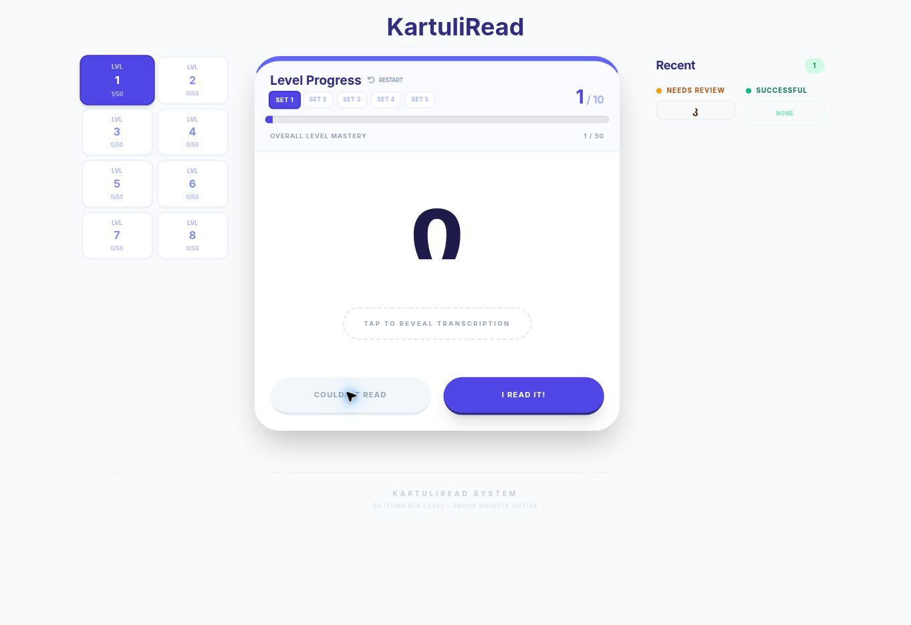
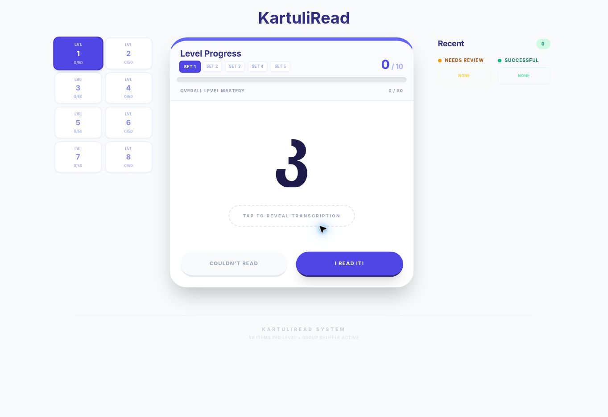
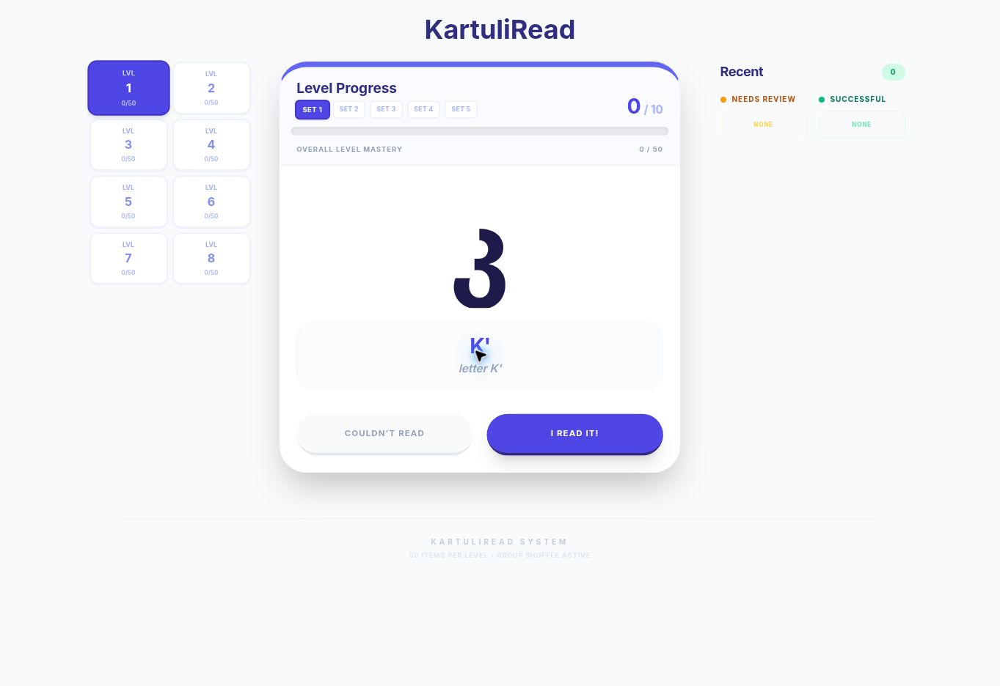
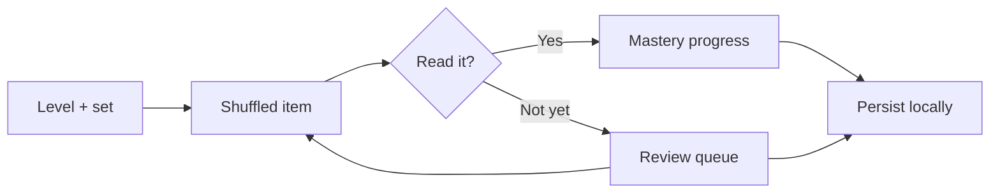

# KartuliRead

**Adaptive Georgian reading practice with progressive levels and repetition of missed items.**

KartuliRead teaches recognition before translation: the learner reads Georgian script, reveals the transcription when needed, and records whether the item was read successfully. Missed items return for another attempt.



[Open the deployed app](https://kartuliread.vercel.app)

## Why it exists

Beginning Georgian learners can memorize vocabulary while still decoding the alphabet too slowly to read. KartuliRead isolates that bottleneck and gives the learner a short, repeatable recognition loop.

The app avoids a generic flash-card sequence. Content is arranged into eight levels and five sets per level, progress is explicit, and missed items feed a repetition queue until they can be read.

## What it does

- organizes Georgian reading material into eight progressive levels;
- presents one Georgian item at a time without exposing the answer;
- reveals transcription and meaning on demand;
- records successful and missed items separately;
- repeats missed items in a dedicated review mode;
- tracks set and level mastery;
- persists progress and mastery state in the browser;
- adapts typography and layout across phone and desktop screens.

| Read first | Reveal when needed | See what needs review |
| --- | --- | --- |
|  |  |  |

## How it works



The React client loads a static, pre-generated exercise library. A level contains five sets of ten items. Session state tracks the current group, successful history, failed queue, and repetition index; persisted state restores per-level progress and completed sets.

No model API is called at runtime. Static content keeps the learning loop fast, deterministic, and usable without an account.

## A few implementation notes

- **Error-driven repetition:** missed items become the next review set rather than disappearing into a score.
- **Mastery hierarchy:** progress is modeled at item, set, and level granularity.
- **Deterministic runtime content:** exercises are validated and built ahead of time.
- **Persistence:** progress, completed sets, and learning state survive reloads.
- **Responsive reading UI:** Georgian and transcription font sizes are fitted independently to the available space.
- **Data validation tooling:** repository scripts check exercise integrity and regenerate letter-count references.

## Tech stack

React 19, TypeScript, Vite, CSS, browser local storage, static exercise data.

## Running locally

```bash
npm ci
npm run check:data
npm run dev
```

## Checks

```bash
npm run check:data
npm run typecheck
npm run build
```

## Current state

**Working web application with a deployed version.** All eight levels, progress tracking, mastery state, missed-item repetition, responsive layout, and local persistence are implemented.

## Android app

KartuliRead also runs as an offline Android app using Capacitor 8. The APK includes
all exercises, Georgian and English fonts, styles, and icons. It loads the bundled
React application; it does not load the deployed website.

- App ID: `com.sebastiankristof.kartuliread`
- Android 7.0 (API 24) or newer
- Native Preferences storage for level progress and completed sets
- Safe-area padding for status bars, navigation bars, and display cutouts
- Android Back closes an open dialog/menu before exiting
- No account or network connection required for practice

### Build and install

Use Node 22+, JDK 21, and Android SDK platform 36 / build-tools 36.0.0.
Android Studio can install the SDK; set `ANDROID_HOME` or configure
`android/local.properties` with your local SDK path.

```bash
npm ci
npm run check:data
npm run typecheck
npm test
npm run android:debug
```

Install `android/app/build/outputs/apk/debug/app-debug.apk` on a phone, or run:

```bash
adb install -r android/app/build/outputs/apk/debug/app-debug.apk
```

`npm run android:open` rebuilds/syncs web assets and opens Android Studio.
Run `npm run cap:sync` after changing web code or native plugins.
`npm run check:offline` checks the built HTML/CSS/manifest for missing or remote assets.

The **Android APK** GitHub Actions workflow builds and uploads an installable debug
APK on pull requests, pushes to main, and manual runs. Download
`KartuliRead-Android-debug` from the run's artifacts and extract the APK.
Debug builds are for testing. A Play Store release requires a release signing key
and a signed release bundle; no release credentials are stored in this repository.
CI debug signing keys can change between runs; if Android refuses an update due
to a different signature, uninstalling clears app progress. Use a consistent signing
key for ongoing distribution.

iOS is not generated in this first Android release.

### Progress and offline behavior

Browser progress remains in the browser's existing local storage. The Android app
uses its own native Preferences store; it does not automatically import progress
from the website or sync across devices. An older installation's WebView progress
is migrated when available. Saved level progress and completed sets survive app
restarts; an unfinished session's shuffle/review queue is still in memory, as in
the web version. Uninstalling the app clears local progress.

Storage hydration completes before mounting React. Save errors display a retry
message rather than claiming progress was saved. Tests cover hydration, write order,
startup failures, and retrying failed writes.

### Device checks before release

Install the APK and check first launch in airplane mode, Georgian rendering,
portrait/landscape layout, system-bar insets, Back through menus/dialogs, and
progress after force-stopping and reopening the app. Browser checks cannot verify
native Android lifecycle, hardware Back, or device-specific display cutouts.

Third-party font and icon license notices are in `THIRD_PARTY_NOTICES.md`.

## License

No open-source license has been declared.
